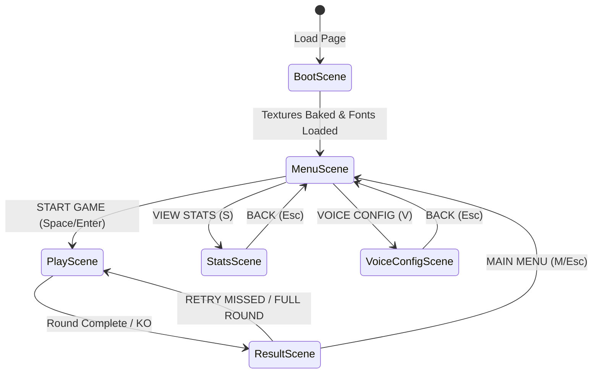

# Technical Architecture & Engineering Guide

This document provides a comprehensive technical overview of **Tae Kwon-Do Trainer**, including its architecture, game loop, procedural asset generation, audio synthesis, speech engine, algorithms, and deployment pipeline.

---

## 1. System Architecture Overview

The application is built as a single-page HTML5 game using **Phaser 3** and **TypeScript**, bundled with **Vite**. The architecture is 100% self-contained: it requires **zero external image or audio asset files**, generating all pixel art and chiptune sound effects procedurally in-memory.

```
┌─────────────────────────────────────────────────────────┐
│                       index.html                        │
│                 (HTML5 Canvas Container)                │
└────────────────────────────┬────────────────────────────┘
                             │
                             ▼
┌─────────────────────────────────────────────────────────┐
│                     src/main.ts                         │
│            Phaser Game Config & Resize App              │
└────────────────────────────┬────────────────────────────┘
                             │
     ┌───────────────────────┴───────────────────────┐
     ▼                                               ▼
┌──────────────────────────┐          ┌──────────────────────────┐
│        Game Scenes       │          │      Core Utilities      │
│  • BootScene             │          │  • pixelTextures.ts      │
│  • MenuScene             │◄────────►│  • soundEffects.ts       │
│  • PlayScene             │          │  • pronunciation.ts      │
│  • ResultScene           │          │  • deckBuilder.ts        │
│  • StatsScene            │          │  • progress.ts           │
│  • VoiceConfigScene      │          └──────────────────────────┘
└────────────┬─────────────┘                         ▲
             │                                       │
             ▼                                       │
┌──────────────────────────┐                         │
│       Game Objects       │                         │
│  • Player.ts             │                         │
│  • Enemy.ts              │─────────────────────────┘
│  • ActionDeck.ts         │
└──────────────────────────┘
```

---

## 2. Directory Structure

```
├── .github/
│   └── workflows/
│       └── deploy.yml          # GitHub Actions CI/CD pipeline
├── docs/
│   ├── TECHNICAL.md            # This document
│   ├── DESIGN.md               # Game design & educational philosophy
│   └── SYLLABUS.md             # TAGB martial arts curriculum reference
├── index.html                  # HTML entry point with retro styling & meta tags
├── package.json                # Project dependencies & scripts
├── tsconfig.json               # TypeScript compiler configuration (strict mode)
├── vite.config.ts              # Vite bundler configuration
├── test/
│   └── syllabus.test.ts        # Syllabus integrity & distractor verification
└── src/
    ├── main.ts                 # Phaser game initialization & viewport handler
    ├── data/
    │   ├── types.ts            # Core TypeScript interfaces & domain types
    │   ├── dictionary.ts       # Korean root word to English translations
    │   ├── progress.ts         # LocalStorage player stats & accuracy persistence
    │   └── grades/
    │       ├── index.ts        # Grades registry & helper accessors
    │       ├── kup9.ts         # 9th Kup (Yellow Tag / Chon-Ji)
    │       ├── kup8.ts         # 8th Kup (Yellow Belt / Dan-Gun)
    │       └── kup7.ts         # 7th Kup (Green Tag / Do-San)
    ├── objects/
    │   ├── ActionDeck.ts       # 4-button multiple choice container with hotkeys
    │   ├── Player.ts           # Player sprite, animations, health & combo logic
    │   └── Enemy.ts            # Enemy sprite, combat AI & hit reaction states
    ├── scenes/
    │   ├── BootScene.ts        # Texture baking & initial asset orchestration
    │   ├── MenuScene.ts        # Title screen, belt selection & game configuration
    │   ├── PlayScene.ts        # Main combat quiz loop & encounter manager
    │   ├── ResultScene.ts      # Scoring, mistake review & retry missed mode
    │   ├── StatsScene.ts       # Term accuracy analytics & rolling averages
    │   └── VoiceConfigScene.ts # Speech synthesis device voice picker & pitch tool
    └── utils/
        ├── deckBuilder.ts      # Spaced-repetition weighted deck generator
        ├── pixelTextures.ts    # Procedural 8-bit HTML5 Canvas texture generator
        ├── pronunciation.ts    # Web Speech API speech synthesis manager
        └── soundEffects.ts     # Web Audio API procedural sound synthesizer
```

---

## 3. Game Lifecycle & Scene State Machine

The game flows through six distinct Phaser scenes:



### Scene Responsibilities:

1. **`BootScene` (`src/scenes/BootScene.ts`)**:
   - Executes once at startup.
   - Calls `createPixelArtTextures(this)` to procedurally render all sprites, backgrounds, dust particles, and UI elements to HTML5 offscreen canvases and register them in Phaser's Texture Manager.
   - Verifies the `'Press Start 2P'` Google webfont is ready before launching `MenuScene`.

2. **`MenuScene` (`src/scenes/MenuScene.ts`)**:
   - Manages belt grade selection (9th Kup, 8th Kup, 7th Kup).
   - Renders live character and opponent previews with dynamic belt colors and stripes.
   - Provides toggle switches for **Hard Mode** (speed timer) and **Cumulative Exam Mode** (all prerequisite belts).
   - Hosts quick action shortcuts: `V` (Voice Config), `S` (Stats), `H` (Hard Mode), `C` (Cumulative Exam), `Space` (Start).

3. **`PlayScene` (`src/scenes/PlayScene.ts`)**:
   - The primary gameplay loop.
   - Instantiates the `Player`, `Enemy`, and `ActionDeck`.
   - Generates the session question deck using `buildEncounterDeck()`.
   - Manages encounter cycles: prompt display, audio callout, input timeout (Hard Mode), combat animations, sound effects, streak calculation, and mistake logging.
   - Transitions to `ResultScene` upon victory (all questions answered) or defeat (health reaches 0).

4. **`ResultScene` (`src/scenes/ResultScene.ts`)**:
   - Evaluates performance against martial arts grading criteria (Pass Plus, Pass, Fail).
   - Displays round statistics (accuracy percentage, score, max combo).
   - Provides interactive **Mistake Review**: lists every question missed with the prompt, the incorrect choice made, the correct answer, and an interactive **`[🔊]`** button to rehearse audio.
   - Offers **`[RETRY MISSED]`** mode which immediately launches a recovery round with *only* the questions missed during that session.

5. **`StatsScene` (`src/scenes/StatsScene.ts`)**:
   - Displays historical metrics stored in `localStorage`: best streak, total enemies defeated, and a sortable breakdown of term accuracy ratios.
   - Calculates rolling averages from recent attempts (`record.history`) to prioritize terms that require attention.

6. **`VoiceConfigScene` (`src/scenes/VoiceConfigScene.ts`)**:
   - Queries `speechManager.getAvailableVoices()` to display all compatible voices on the user's operating system/browser.
   - Filters by language (`ALL`, `KOREAN`, `ENGLISH`).
   - Normalizes raw technical Android identifiers (e.g., `en-gb-x-rjs`) into clean labels (`Google UK English (Voice 2) [MALE]`).
   - Provides a live `[TEST 🔊]` button for every voice.
   - Offers interactive pitch modulation controls (`NATURAL (1.0)`, `LOW (0.85)`, `DEEP (0.75)`, `HIGH (1.15)`).

---

## 4. Procedural Graphics Pipeline

To guarantee instantaneous loading times, zero HTTP network requests for images, and crisp pixel art scaling on any screen density, all graphics are procedurally generated via HTML5 Canvas in `src/utils/pixelTextures.ts`.

### How It Works:
```typescript
const createFromGrid = (
  key: string,
  width: number,
  height: number,
  scale: number,
  renderFn: (ctx: CanvasRenderingContext2D) => void
) => {
  if (scene.textures.exists(key)) return;
  const canvas = document.createElement('canvas');
  canvas.width = width * scale;
  canvas.height = height * scale;
  const ctx = canvas.getContext('2d');
  if (!ctx) return;
  ctx.imageSmoothingEnabled = false;
  ctx.scale(scale, scale);
  renderFn(ctx);
  scene.textures.addCanvas(key, canvas);
};
```

### Generated Assets:
1. **Player Sprites (`player_idle_<gradeId>`, `player_punch_<gradeId>`, `player_kick_<gradeId>`, `player_block_<gradeId>`, `player_hit_<gradeId>`)**:
   - Rendered with white dobok (uniform), skin tones, and black hair.
   - The belt is dynamically painted using the `KupGrade` configuration:
     - Pure yellow for 8th Kup (`#ffe600`).
     - Yellow with green stripe for 7th Kup (`#00a859` center band).
     - White with yellow stripe for 9th Kup.
2. **Opponent Sprites (`enemy_purple`, `enemy_punch`, `enemy_kick`, `enemy_hit`, `enemy_defeat`)**:
   - Rendered with distinct purple training dobok and headbands for immediate visual contrast against the player.
3. **Backgrounds (`dojang_bg`, `dojang_bg_hard`)**:
   - Procedural dojang training hall featuring wooden floorboards, traditional wall paneling, and national flag banners. In Hard Mode, the color scheme shifts to ominous crimson and charcoal tones.
4. **VFX & UI**:
   - Health hearts (`heart_full`, `heart_empty`), dust particles (`dust`), hit sparks (`spark`), and audio replay icons.

---

## 5. Procedural Audio Synthesis Pipeline

Audio effects are synthesized in real-time in `src/utils/soundEffects.ts` using the browser's **Web Audio API** (`AudioContext`). This avoids MP3/WAV file downloads, eliminates audio decoding latency, and delivers authentic 8-bit chiptune sound.

### Synthesizer Capabilities:
- **Square Wave Oscillators (`square`)**: Used for bright arcade melodies, selection chimes (`playSelect`), correct answer jingles (`playCorrect`), combo streak celebrations (`playStreak`), and victory fanfares (`playRoundWin`).
- **Triangle Wave Oscillators (`triangle`)**: Used for lower-frequency thuds such as the player stepping, blocking (`playBlock`), or entering Hard Mode (`playHardMode`).
- **White Noise Buffer Generation**: Created by populating an `AudioBuffer` with random values (`Math.random() * 2 - 1`), routed through a bandpass filter to generate crisp physical impact sounds for punches (`playPunch`), kicks (`playKick`), and opponent defeats (`playDefeat`).
- **Global Sound Mute**: Controlled via `soundFx.toggleSound()` and persisted in `localStorage` (`tagb_sound_enabled`). All synthesis calls check `this.enabled` before opening gain nodes.

---

## 6. Speech Synthesis Architecture

The voice synthesis engine (`src/utils/pronunciation.ts`) provides authentic audio pronunciations using the **Web Speech API** (`window.speechSynthesis`).

### 1. Dual-Language Pronunciation Strategy
- **Native Korean (`ko-KR`)**: When a Korean voice is active, the engine delivers native Hangul characters (e.g. `걷는 서기`, `천지`, `뒤축`). Korean text-to-speech engines synthesize native Hangul with authentic syllable timing and vowel inflection.
- **English Phonetic Transliteration (`en-GB` / `en-US`)**: When an English instructor voice is active, passing native Hangul causes silence or gibberish. Instead, the engine supplies specially constructed phonetic syllables (e.g. `Guhn-noon Soh-gee`, `Chuhn-Jee`, `Dwee-chook`) matching the pronunciation conventions of British TAGB instructors.

### 2. Multi-Platform Voice Discovery & Normalization
Voice identification differs drastically between operating systems:
- **macOS / iOS**: Exposes named human voices (`Reed`, `Eddy`, `Daniel`, `Oliver`, `Alex`, `Yuna`).
- **Android / Chromium**: Exposes internal system codes (`ko-kr-x-ism-local`, `en-gb-x-rjs-local`, `ko_KR`, `en_GB`).
- **Windows**: Exposes SAPI voices (`Microsoft InJoon`, `Microsoft Heami`).

The `parseVoiceMetadata` function decodes these technical identifiers into human-readable labels:
```typescript
// Example Android normalization:
if (lower.includes('en-gb-x-rjs')) return { friendlyName: 'Google UK English (Voice 2)', gender: 'male' };
if (lower.includes('ko-kr-x-ism')) return { friendlyName: 'Google Korean (Voice 2)', gender: 'male' };
```

### 3. Asynchronous Voice Loading & Fallbacks
On Chromium-based mobile browsers (e.g. Chrome on Android), `window.speechSynthesis.getVoices()` returns an empty array `[]` on initial page load until the OS background service connects. The `SpeechManager` solves this via:
1. Registering an `onvoiceschanged` event listener to refresh voices upon load.
2. Re-scanning voices upon user click/tap interactions.
3. Automatically unpausing stalled speech synthesizers via `window.speechSynthesis.resume()`.
4. Stripping punctuation (`[-_!?,.:;()]`) prior to dispatch so synthesis engines never verbalize punctuation marks aloud (e.g. preventing the engine from saying "exclamation mark").

---

## 7. Spaced-Repetition Deck Builder Algorithm

The question deck generator (`src/utils/deckBuilder.ts`) builds an optimal study session for each game round.

### Weighting Formula:
Each term in the grade's syllabus is assigned a dynamic priority weight:

$$\text{Weight}(item) = 
\begin{cases} 
4.0 & \text{if unpracticed (total attempts} = 0) \\
6.0 & \text{if failed on most recent attempt or recent accuracy} < 50\% \\
4.0 & \text{if recent accuracy} < 75\% \\
1.0 & \text{if mastered (recent accuracy} \ge 85\% \text{ and total attempts} \ge 3) \\
2.0 & \text{otherwise}
\end{cases}$$

If the session is running in **Cumulative Exam Mode**, terms belonging to the student's current grade receive a $1.5\times$ weight multiplier to ensure the primary belt remains the main focus while lower belts are tested periodically.

### Sampling Without Replacement:
To prevent duplicate questions in a single round, the deck builder uses weighted sampling without replacement:
```typescript
while (selected.length < count && available.length > 0) {
  const weights = available.map(getWeight);
  const totalWeight = weights.reduce((sum, w) => sum + w, 0);
  let rand = Math.random() * totalWeight;

  for (let i = 0; i < available.length; i++) {
    rand -= weights[i];
    if (rand <= 0) {
      selected.push(available[i]);
      available.splice(i, 1);
      break;
    }
  }
}
```

---

## 8. State Persistence & LocalStorage Schema

All player progress, scores, and configuration are persisted in browser `localStorage`. No remote server or account setup is required.

| Key | Type | Description |
| :--- | :--- | :--- |
| `tagb_player_stats` | `JSON string` | Total score, best streak, enemies defeated, and per-term accuracy history (`PlayerStats`). |
| `tagb_selected_grade`| `string` | The active Kup grade identifier (e.g. `'8th-kup'`). |
| `tagb_hard_mode` | `'true' \| 'false'` | Whether Hard Mode speed timer is enabled. |
| `tagb_cumulative_exam`| `'true' \| 'false'` | Whether Cumulative Exam Mode is enabled. |
| `tagb_sound_enabled` | `'true' \| 'false'` | Global audio FX mute toggle. |
| `tagb_preferred_voice_uri` | `string` | Selected speech synthesis voice URI or `'auto'`. |
| `tagb_voice_pitch` | `string (float)` | User-defined pitch override (e.g. `'1.0'`, `'0.75'`). |

---

## 9. Mobile Responsiveness & Viewport Management

The game is designed for a native pixel resolution of **480 × 270** (a 16:9 widescreen arcade aspect ratio).

### Scaling Strategy:
- **Phaser Scale Mode**: `Phaser.Scale.FIT` with `Phaser.Scale.CENTER_BOTH`. The canvas scales dynamically to fill any display (mobile phone, iPad, desktop monitor) while preserving the 16:9 aspect ratio without stretching.
- **Dynamic Resize Listener**: `src/main.ts` listens for `window.resize` and `window.orientationchange` events, refreshing Phaser's scale manager to handle mobile browser address bars sliding in and out.
- **Touch-First UI**:
  - Minimum touch target height for answer cards is 44px.
  - Buttons feature generous touch zones (`Phaser.GameObjects.Zone`).
  - Viewport meta tags disable double-tap zoom: `user-scalable=no, viewport-fit=cover`.

---

## 10. Build, Test & CI/CD Pipeline

### 1. Build Verification
```bash
# Typecheck with TypeScript compiler then bundle via Vite
npm run build
```
The build pipeline enforces strict TypeScript checking (`noImplicitAny`, `strictNullChecks`, `noUnusedLocals`).

### 2. Syllabus Automated Test
```bash
npx tsx test/syllabus.test.ts
```
The test suite validates:
- All required syllabus terms exist and contain non-empty Korean and English pairs.
- Distractor options for multiple-choice questions are unique and do not contain the correct answer.
- Pattern movement counts and historical meanings are accurate.

### 3. Continuous Deployment (GitHub Actions)
`.github/workflows/deploy.yml` triggers on every push to `main`:
1. Checks out repository code.
2. Sets up Node.js v20 with npm cache.
3. Installs clean dependencies via `npm ci`.
4. Runs `npm run build` to generate `/dist`.
5. Uploads `/dist` as a GitHub Pages artifact.
6. Deploys artifact to `https://monquixote.github.io/taekwondo-trainer/`.
